<div align="center">


# OrbitCRM

**An open-source, multi-tenant CRM with built-in team chat and Microsoft Teams-style presence.**

Leads, contacts, companies, deals, activities and a pipeline board for any number of companies on one installation.
Your team can chat in real time, and your status follows your calendar: start a meeting and colleagues see *In a meeting*.

[](LICENSE)


[What makes it different](#what-makes-it-different) ·
[Chat and presence](#team-chat-with-teams-style-presence) ·
[Screenshots](#a-quick-tour) ·
[Quick start](#quick-start) ·
[Architecture](#architecture) ·
[Roadmap](#roadmap)

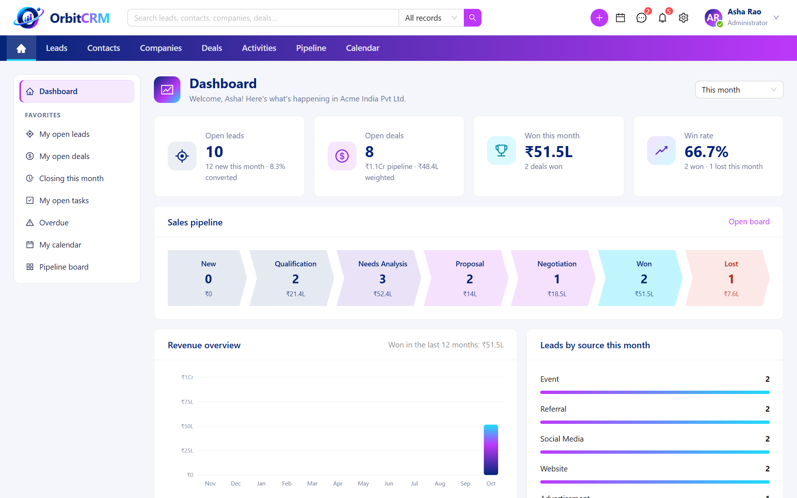

</div>

## What makes it different

| Highlight | What it means |
|---|---|
| 💬 **Chat that knows your calendar** | Direct messages are built into the CRM, with live delivery, typing indicators and read receipts. Presence follows your CRM calendar: when a meeting you own or attend starts, your status turns *In a meeting* on its own. When it ends, your status goes back. |
| 🛡️ **Isolation enforced by the database** | Every company's data lives in one database, but PostgreSQL row-level security only lets each workspace see its own rows. A bug in a query can't leak another company's data, because the database itself refuses. |
| ⚡ **Real time with no extra infrastructure** | Live events use server-sent events over the normal API. They reach every server instance through PostgreSQL `LISTEN/NOTIFY`. There's no Redis, Kafka or WebSocket gateway to run. |
| 🧩 **One engine for every module** | Leads, contacts, companies, deals and activities are described by metadata. One record engine provides create/read/update/delete, validation, filters, saved views, bulk actions, audit, search and CSV import/export for all of them. It's ready for custom fields. |
| 🔐 **Secure by default** | Rotating refresh tokens with reuse detection in an HttpOnly cookie. TOTP two-step login, login lockout and API rate limiting. An append-only audit log, file-type checks on uploads and CSV exports that are safe against formula injection. |
| 👥 **Access by role and scope** | Each role decides, for every module and action, whether a user works on their *own* records, their *team's* or *everyone's*. The server enforces this in SQL. Records you can't see simply don't exist for you. |
| ✅ **Tested against the real thing** | 80 automated tests. 70 of them are integration tests against a real PostgreSQL 18 (Testcontainers), using the same restricted database role as production. Spring Modulith fails the build if one module reaches into another's internals. |

## Team chat with Teams-style presence

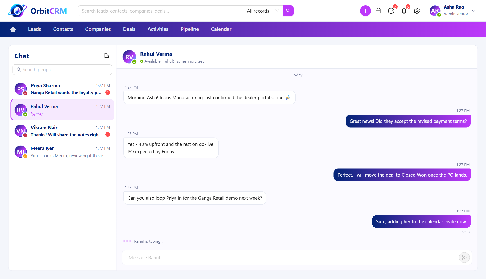

Chat is part of the CRM, not a separate tool. An admin can see that a sales manager is available and message them right away, without leaving the leads and deals they're discussing.

- **Live messages:** messages appear instantly in every open tab of every participant.
- **Typing and receipts:** a "Rahul is typing…" indicator, plus a **Seen** receipt when the other person has read your message.
- **Edit and delete:** you can change or remove your own messages; the change is pushed live to the other person.
- **Unread counts everywhere:** on the header icon, on each conversation, and in the browser tab title, e.g. `(2) OrbitCRM`.
- **Notifications:** a toast while you're in the app, a desktop notification while the tab is in the background, and nothing at all in *Do not disturb*.
- **No lost or duplicate messages:** each message carries an id generated by your app, so a retry after a network error can't create a duplicate. Unsent messages show **Not sent · Retry**. After a dropped connection the app shows *Reconnecting…* and catches up on everything it missed.
- **Works on phones:** the chat list, then the conversation with a back button.

<table>
  <tr>
    <td width="62%" valign="top">
      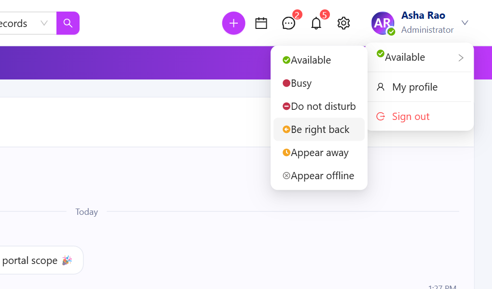<br>
      <sub>Choose a status from your avatar, or leave it on automatic.</sub>
      <h3>Presence</h3>
      <table>
        <tr><th>Status</th><th>How it's set</th></tr>
        <tr><td>🟢 Available</td><td>Automatic while you have OrbitCRM open, or chosen</td></tr>
        <tr><td>🔴 In a meeting</td><td><b>Automatic</b> while a meeting activity you own or attend is in progress</td></tr>
        <tr><td>🔴 Busy<br>⛔ Do not disturb</td><td>Chosen; <i>Do not disturb</i> also mutes notifications</td></tr>
        <tr><td>🟡 Be right back<br>🟡 Away</td><td>Chosen, or <b>automatic</b> <i>Away</i> after 5 minutes without keyboard or mouse input in any tab</td></tr>
        <tr><td>⚪ Offline</td><td>Automatic within seconds of closing the app, or chosen as <i>Appear offline</i></td></tr>
      </table>
    </td>
    <td width="38%" valign="top">
      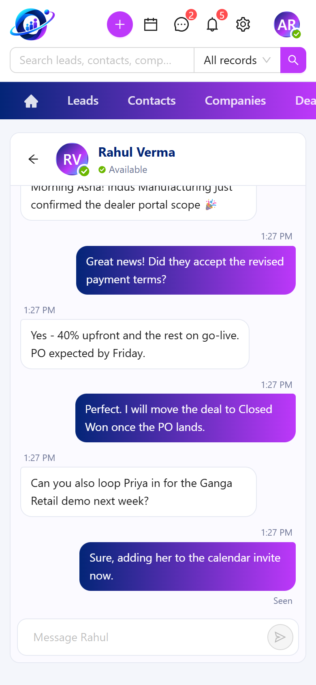<br>
      <sub>The same chat on a phone.</sub>
    </td>
  </tr>
</table>

Presence is never stored as a stale value; it's worked out from live facts each time:

- the open tabs, each keeping a heartbeat on any server instance;
- the status you chose;
- whether your tabs are idle;
- the meetings on your calendar.

If a server crashes, its users drop to Offline within a minute or two, with no coordination needed.

## A quick tour

<table>
  <tr>
    <td width="50%" valign="top">
      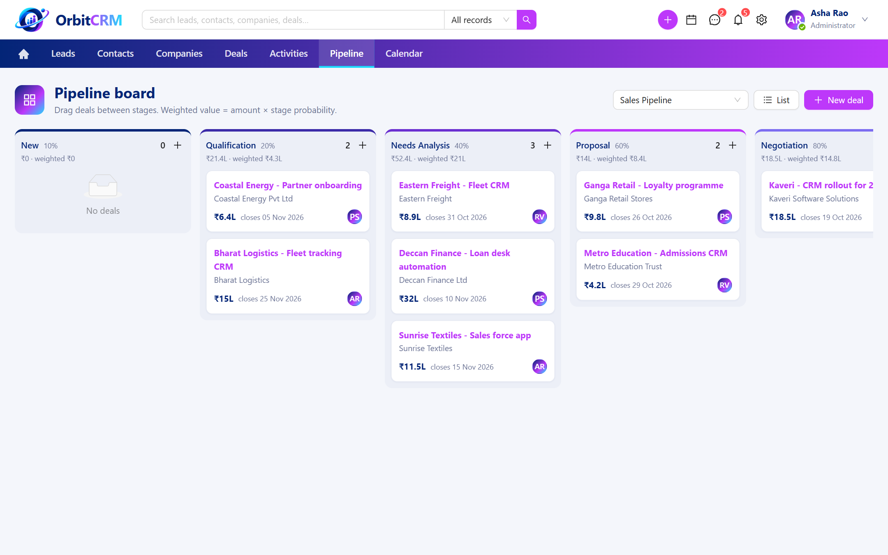<br>
      <b>Pipeline board.</b> Drag deals between stages, with totals and weighted forecasts per stage.
    </td>
    <td width="50%" valign="top">
      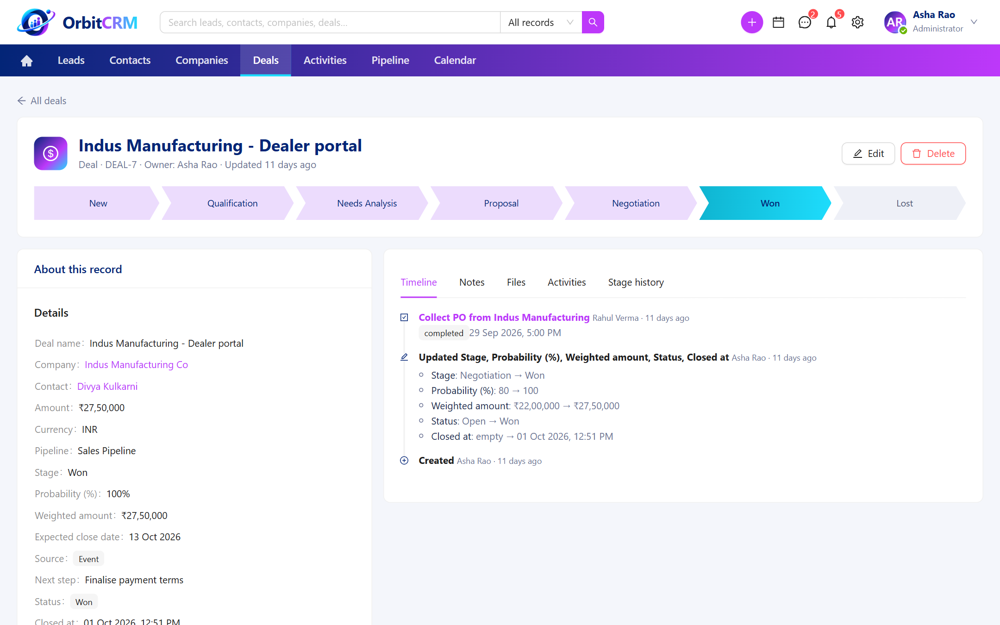<br>
      <b>Record detail.</b> A clickable stage path, plus a timeline of every change, note, file and activity.
    </td>
  </tr>
  <tr>
    <td width="50%" valign="top">
      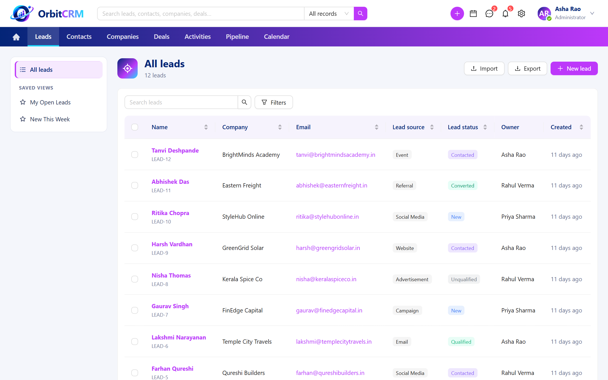<br>
      <b>Lists.</b> Saved views, search, filters, sorting, bulk actions and CSV import and export.
    </td>
    <td width="50%" valign="top">
      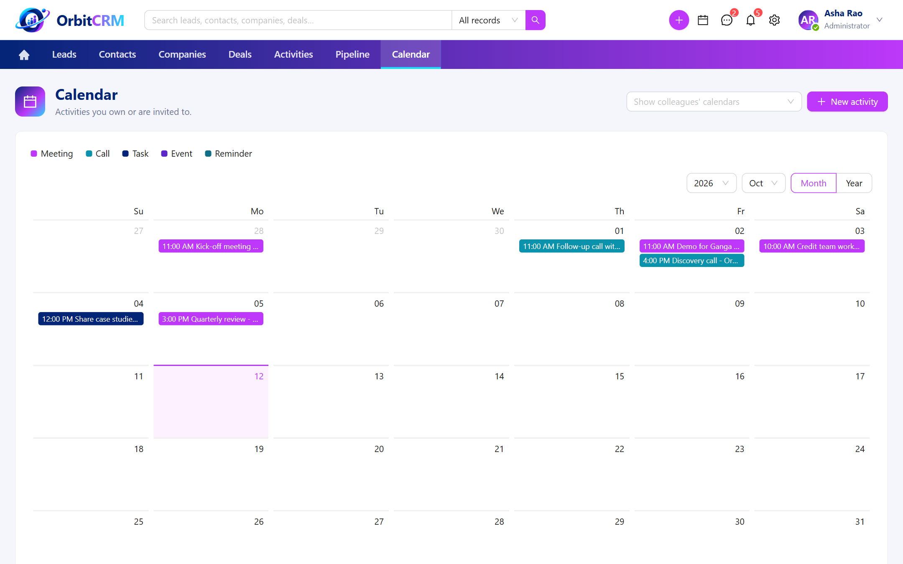<br>
      <b>Calendar.</b> Meetings, calls, tasks and reminders, including colleagues' calendars.
    </td>
  </tr>
  <tr>
    <td width="50%" valign="top">
      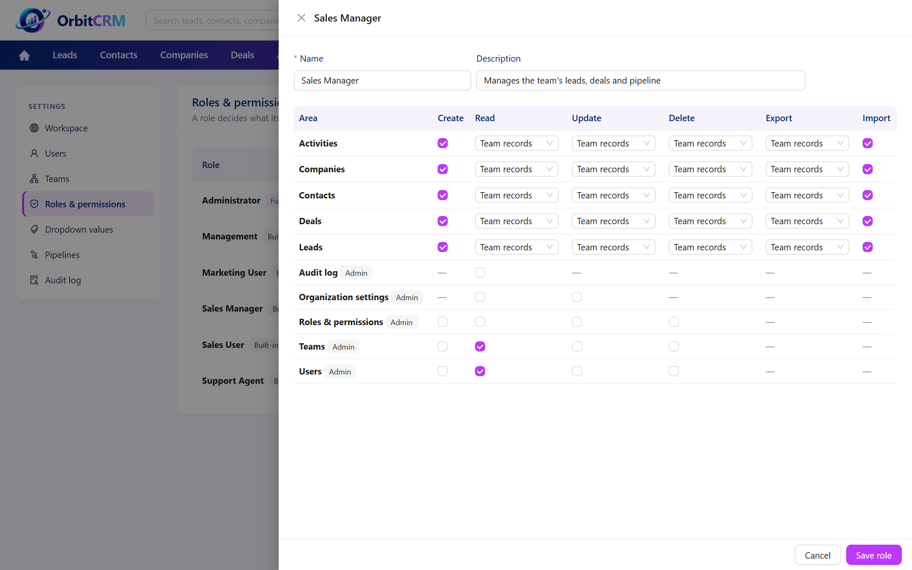<br>
      <b>Roles and permissions.</b> Own, team or all records, for every module and action.
    </td>
    <td width="50%" valign="top">
      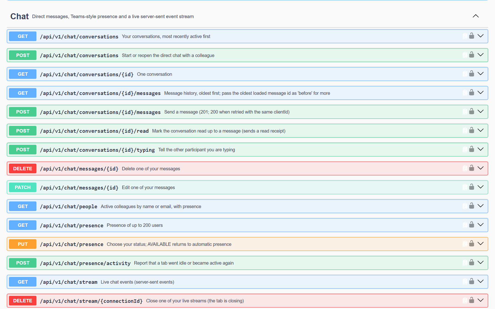<br>
      <b>Documented API.</b> Every endpoint in Swagger UI, ready for API testing.
    </td>
  </tr>
  <tr>
    <td width="50%" valign="top">
      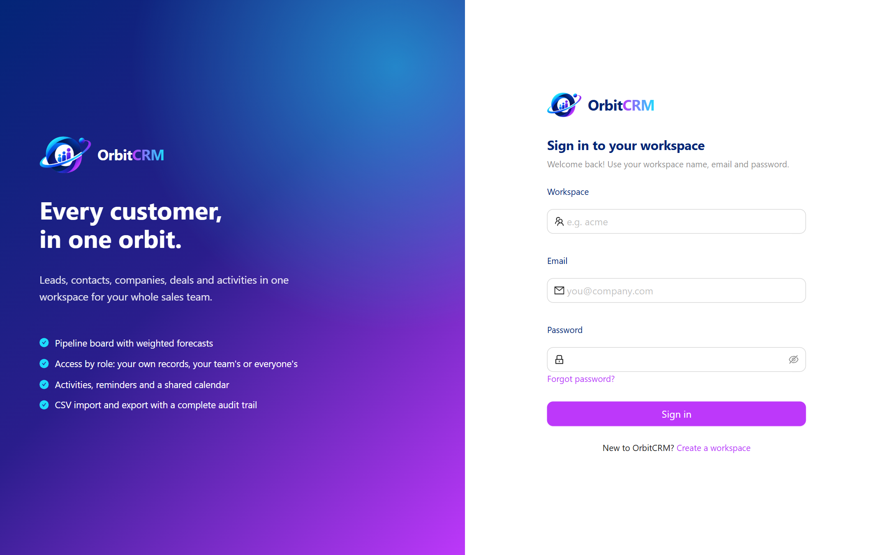<br>
      <b>Workspaces.</b> Each company signs up for its own workspace and invites its team.
    </td>
    <td width="50%" valign="top">
      <b>Everything else included</b>
      <ul>
        <li>Lead conversion to company, contact and deal in one step, with duplicate suggestions</li>
        <li>Dashboard with KPIs, sales funnel, revenue for 12 months and leads by source</li>
        <li>Notes with @mentions, file attachments and in-app notifications</li>
        <li>Activity reminders and a shared calendar</li>
        <li>Global search across all modules</li>
        <li>Recycle bin with restore, and field-level change history</li>
        <li>Teams with sub-teams, user invitations, password reset and two-step login</li>
        <li>Editable dropdown values, pipelines and stages, and an audit log</li>
      </ul>
    </td>
  </tr>
</table>

## Tech stack

| Layer | Technology |
|---|---|
| Backend | Java 21, Spring Boot 4.1, Spring Modulith, Spring Security (JWT), Spring Data JPA and JDBC, Flyway, ShedLock |
| Frontend | React 19, TypeScript, Vite, Ant Design 6, TanStack Query, React Router |
| Database | PostgreSQL 18 with row-level security, trigram search and `LISTEN/NOTIFY` |
| Real time | Server-sent events, PostgreSQL `LISTEN/NOTIFY` between instances |
| Storage | Local disk or any S3-compatible service (AWS S3, MinIO, Cloudflare R2) |
| Testing | JUnit 5, Testcontainers (real PostgreSQL), Spring Modulith boundary checks |
| Operations | Docker image, Actuator health probes, Prometheus metrics, structured JSON logs |

## Architecture

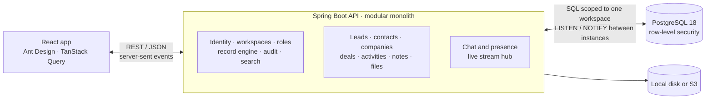

- **One database, many workspaces.** Every row carries its workspace's id.
  - The application filters by it.
  - PostgreSQL row-level security enforces the same rule underneath.
  - Foreign keys include the workspace id, so records can't point across companies.
- **Modular monolith.** Each module (`identity`, `lead`, `deal`, `chat`, …) has its own `controller`, `service`, `repository` and `dto` packages. Modules talk only through public APIs, and the build checks this.

The [backend README](orbitcrm-backend/README.md) covers architecture and configuration in depth, and the [frontend README](orbitcrm-frontend/README.md) covers the web app.

## Quick start

**You need:** Java 21, Maven 3.9+, Node.js 20.19+ (or 22.12+) and Docker (for PostgreSQL and a local mail catcher).

**1. Start the database and mail catcher**

```bash
cd orbitcrm-backend
docker compose up -d
```

**2. Start the API** (in the same folder)

```bash
mvn spring-boot:run -Dspring-boot.run.profiles=local
```

On Windows PowerShell, quote the `-D` argument:

```powershell
mvn spring-boot:run "-Dspring-boot.run.profiles=local"
```

**3. Start the web app** (in a second terminal)

```bash
cd orbitcrm-frontend
npm install
npm run dev
```

**4. Open http://localhost:5173 and click "Create a workspace".**

| What | Where |
|---|---|
| Web app | http://localhost:5173 |
| API documentation (Swagger) | http://localhost:8080/swagger-ui.html |
| Invitation and password emails (Mailpit) | http://localhost:8025 |
| Health check | http://localhost:8080/actuator/health |

**To try the chat:**

1. Invite a colleague from *Settings → Users*.
2. Open the invitation email in Mailpit and accept it in a second browser or a private window.
3. Message each other: you'll see presence, typing indicators and read receipts live.

## Running the tests

```bash
cd orbitcrm-backend
mvn test              # 80 tests (70 against a real PostgreSQL); Docker must be running

cd ../orbitcrm-frontend
npm run lint
npm run build         # type-checks and builds the app
```

## Project structure

```
OrbitCRM/
├── orbitcrm-backend/     Spring Boot API: one package per module (identity, lead, deal, activity, chat, ...)
│   ├── src/main/resources/db/migration/   Flyway migrations, including row-level security policies
│   └── docs/phases.md                     How the backend was built, phase by phase
├── orbitcrm-frontend/    React and TypeScript web app (pages, chat, metadata-driven record screens)
└── docs/screenshots/     Images used in this README
```

## Deploying

The defaults in this repository are for local development only. Before running OrbitCRM anywhere others can reach it:

1. **Generate your own secrets.** Set `ORBITCRM_JWT_SECRET` and `ORBITCRM_ENCRYPTION_KEY`. The development values are public in this repository and must never be used in production.
2. **Run with the `prod` profile.** It switches to JSON logs, requires the secrets and turns Swagger off.
3. **Set the frontend origin and URL:** `ORBITCRM_CORS_ORIGINS` and `ORBITCRM_FRONTEND_URL`.
4. **Serve the frontend.** Serve `orbitcrm-frontend/dist/` and route `/api` to the backend on the same domain.

All settings are listed in the [backend README](orbitcrm-backend/README.md#configuration).

## Roadmap

- [ ] Group chats and file sharing in chat
- [ ] One-click installer for local testing (no Docker needed)
- [ ] Platform console for operators (workspace statistics; support access with customer consent)
- [ ] Products, price books, quotes (PDF), sales orders and invoices
- [ ] Support tickets with SLAs, and a knowledge base
- [ ] Campaigns and marketing lists
- [ ] Report builder
- [ ] Workflow automation, approvals and webhooks
- [ ] Custom fields and custom modules per workspace

## Contributing

Issues and pull requests are welcome. Before opening a pull request:

1. Run the backend tests and the frontend lint and build (see [Running the tests](#running-the-tests)).
2. Follow the existing structure: a new backend feature belongs in its own module with layered packages, and every Java class has a Javadoc comment explaining its purpose.
3. Keep changes focused, and describe what you changed and why.

Found a security problem? Please report it privately through the repository's **Security** tab rather than in a public issue.

## License

OrbitCRM is released under the [MIT License](LICENSE).
